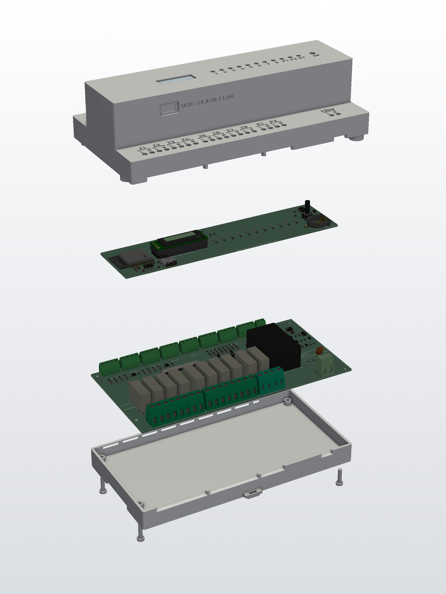
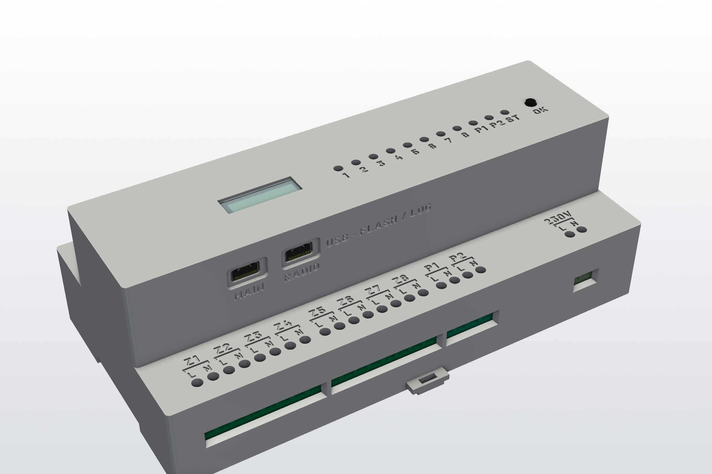
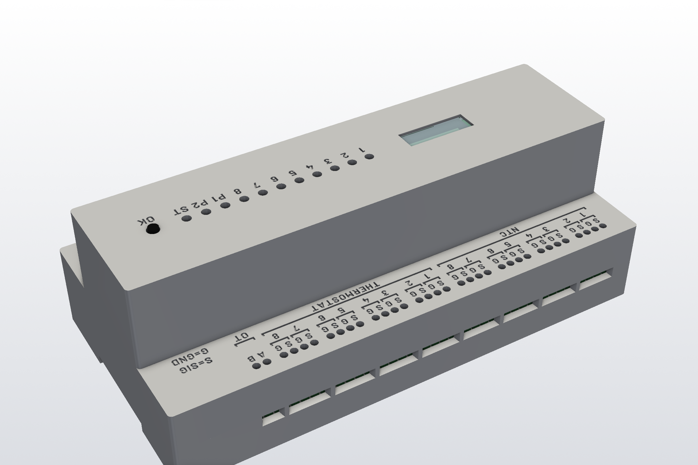

# ESP Heating Control

An open-source, DIN-rail mounted controller for hydronic underfloor heating: 8 zone valve outputs, 2 pump outputs, a built-in OpenTherm master for the boiler, 8 floor NTC probe inputs, 8 dry-contact thermostat inputs, wired Ethernet (RJ45) and Wi-Fi, an 802.15.4 radio for Zigbee or Thread, an RTC, and a front panel with LEDs, an OLED and a button. It is built around an ESP32-S3 and runs either ESPHome (with Home Assistant as the user interface, and Zigbee sensors through the ESP32-H2) or a custom ESP-IDF firmware with a Thread border router and a Matter controller. It also works without Home Assistant.

| Closed, 230 V side | Closed, low-voltage side |
|---|---|
|  |  |

> **Status: design complete, not yet built.** Both PCBs are routed and pass DRC, and the enclosure passes a collision check against the 3D board models. Nothing has been manufactured or tested yet, and the firmware is written but untested. See [docs/open-issues.md](docs/open-issues.md).
>
> **Safety:** the lower board switches mains voltage (230 V AC). Build and install it only if you are qualified to work on mains wiring. The printed enclosure materials are not flame-rated (UL94 V-0), so the design is not suitable for sale as is.

## Features

* **Housing:** 10-module DIN-rail enclosure (175 × 90 mm), the usual circuit-breaker profile. 3D printed (SLA resin, with an MJF nylon DIN latch) with engraved terminal labels for hand painting, a printed spring latch for the DIN rail and printed light pipes.
* **Mains side:** 8 zone outputs (L + N each) for 230 V valve actuators and 2 pump outputs. 10 × Omron G5NB relays, HLK-5M05 power supply, fuse and varistor. 5.08 mm screw terminals rated 16 A / 300 V. At least 6.5 mm creepage/clearance between mains and low voltage.
* **Low-voltage side:** 8 floor NTC inputs (2 × ADS1115, 10 kΩ 0.1 % dividers, 10 µF filter capacitors), 8 dry-contact thermostat inputs (ESD-protected, 3.3 mA wetting current), a discrete OpenTherm master interface (24 V boost, current-limited line driver, polarity-independent), and 10/100 Ethernet (W5500 with an RJ45 jack). 3.5 mm screw terminals for the inputs and OpenTherm; the RJ45 ("LAN") sits at the right end of the same terminal row.
* **Logic board:** ESP32-S3-WROOM-1-N16R8 (16 MB flash, 8 MB octal PSRAM, Wi-Fi 4, BLE; module rated to 65 °C) plus an ESP32-H2-MINI-1 as 802.15.4 co-processor (Zigbee coordinator, or Thread radio for the S3's border router and Matter controller), wired Ethernet (W5500) on the power/IO board, DS3231M RTC with CR1220 backup, 0.91" 128 × 32 OLED, 11 status LEDs, one button, and a USB-C port per chip ("MAIN" for the S3, "RADIO" for the H2) for flashing and logging.
* **Connectivity:**
  * **Ethernet:** 10/100 through an RJ45 jack ("LAN", W5500).
  * **Wi-Fi:** 2.4 GHz Wi-Fi 4 on the ESP32-S3.
  * **ESPHome firmware:** both interfaces run by default, and Ethernet is used whenever the cable is plugged in and has a link. If the link drops, the controller falls back to Wi-Fi, and it returns to Ethernet when the cable is back. A switch turns Wi-Fi off for a wired-only setup; Ethernet-only and Wi-Fi-only builds are also available.
  * **Thread/Matter firmware:** the same choice is made at run time (`auto` / `ethernet` / `wifi`), and the active interface also carries the Thread border router's backbone.
  * **802.15.4 radio (ESP32-H2):** Zigbee or Thread devices.
  * **Bluetooth LE (S3):** Matter commissioning.
  * **Local control:** the controller keeps working without any network; only the dashboard, remote control and the clock sync need it, and the DS3231 RTC keeps the schedules running in between.
  * Details: [firmware/controller](firmware/controller/README.md#network-ethernet-andor-wi-fi), [firmware/thread-matter](firmware/thread-matter/README.md).
* **Manufacturing:** both boards are designed for single-side assembly and can be made by any PCB assembly service, JLCPCB for example. The Gerbers, BOM and CPL are included; the BOM/CPL files are in JLCPCB format and may need adapting for other services. The enclosure can be printed by any 3D printing service with SLA resin (and MJF nylon for the DIN latch and the OLED spacer), e.g. JLC3DP, which can also fit the threaded inserts. Hand work is limited to soldering the OLED module, fitting the window and final assembly.
* **Parametric:** the PCBs (KiCad) and the enclosure (CadQuery) are generated from Python scripts. The enclosure reads terminal and front-panel positions from the boards, so the two stay in sync.

## Repository layout

| Path | Contents |
|---|---|
| [docs/](docs) | Documentation (see below) |
| [hardware/pcb/lower/](hardware/pcb/lower) | Power/IO board (170 × 85 mm): KiCad project and terminal map; `fab/`: Gerbers, BOM/CPL (JLCPCB format) |
| [hardware/pcb/logic/](hardware/pcb/logic) | Logic board (165 × 40 mm): KiCad project and front-panel map; `fab/`: Gerbers, BOM/CPL (JLCPCB format) |
| [hardware/pcb/scripts/](hardware/pcb/scripts) | PCB generators and post-processing scripts |
| [hardware/pcb/components/](hardware/pcb/components) | Part library from LCSC/EasyEDA: `footprints.pretty/` (KiCad footprints) and `3d-models/` (STEP models) |
| [hardware/pcb/schematics/](hardware/pcb/schematics) | OpenTherm master interface schematic (SVG + generator) |
| [hardware/enclosure/models/](hardware/enclosure/models) | Enclosure parts: STL, STEP, OLED window DXF |
| [hardware/enclosure/drawings/](hardware/enclosure/drawings) | Threaded-insert drawing for the order |
| [hardware/enclosure/scripts/](hardware/enclosure/scripts) | CadQuery / VTK scripts |
| [hardware/enclosure/fonts/](hardware/enclosure/fonts) | Label font (Barlow Bold, SIL OFL) |
| [hardware/renders/](hardware/renders) | All images: board renders, assembly and enclosure views, shaded renders, label close-ups |
| [firmware/](firmware) | Controller firmware (all control runs on the controller): ESPHome + Zigbee co-processor, or ESP-IDF with Thread border router and Matter controller; the predecessor gateway's configuration for reference |
| [home-assistant/](home-assistant) | Home Assistant dashboard (the controller works without Home Assistant; HA is only dashboard and remote control) and optional notifications |

## Documentation

1. [Hardware: boards, pinout, OpenTherm interface](docs/hardware.md)
2. [Enclosure: dimensions, terminals, front panel, mounting, printing](docs/enclosure.md)
3. [Ordering and assembly](docs/assembly.md)
4. [Firmware and control logic](docs/firmware.md)
5. [Regenerating the design (build scripts)](docs/build-scripts.md)
6. [Open issues](docs/open-issues.md)

## Contributing

Contributions are welcome, especially reviews of the board designs and the circuitry before the first boards are built. See [CONTRIBUTING.md](CONTRIBUTING.md).

## Background

This controller grew out of a working home installation: an OpenTherm gateway (ESP32 + DIYLess OpenTherm Master Shield + 2 × ADS1115 on a custom PCB), a Zigbee 6-channel relay for the zone valves, Zigbee room thermostats and Home Assistant automations. It puts all of this into one DIN-rail device that can control the heating locally. The Home Assistant packages in [home-assistant/](home-assistant) are the reference implementation of the control logic, which the controller firmware will port to the ESP.

## Disclaimer

All designs, files and documentation in this repository are provided "as is", without warranty of any kind, express or implied. They have not been certified or tested for compliance with any safety or electrical standard. Anyone who builds, modifies, installs or uses them does so entirely at their own responsibility and risk.

The device switches 230 V mains. Mains wiring must be done only by a qualified person and in line with local regulations. The authors accept no liability for any damage, injury or loss resulting from the use of these designs.

## Next Steps

The project is currently in active development. Key next steps include:
- Completing the hardware design review and initial board fabrication.
- Add web UI with the features specified in the [web UI plan](docs/web-ui-plan.md).
- Implementing the firmware features as outlined in the [web UI plan](docs/web-ui-plan.md).
- Testing the integration of the OpenTherm interface, Zigbee components, and the local control logic.
- Expanding the documentation to cover setup, usage, and troubleshooting.
- Gathering feedback from early adopters and contributors to refine both hardware and software.

## License

* Hardware (KiCad files, Gerbers, enclosure models and drawings): [CERN-OHL-S-2.0](LICENSES/CERN-OHL-S-2.0.txt)
* Software (Python scripts, ESPHome and Home Assistant configuration): [MIT](LICENSES/MIT.txt)
* Documentation and images: [CC BY-SA 4.0](LICENSES/CC-BY-SA-4.0.txt)

Third-party content keeps its own license: the Barlow font (SIL OFL 1.1, [hardware/enclosure/fonts/OFL.txt](hardware/enclosure/fonts/OFL.txt)), the KiCad standard library footprints and 3D models (CC BY-SA 4.0 with the KiCad library exception), and the LCSC/EasyEDA footprints and 3D models in [hardware/pcb/components/](hardware/pcb/components) (provided by LCSC, subject to their terms).
