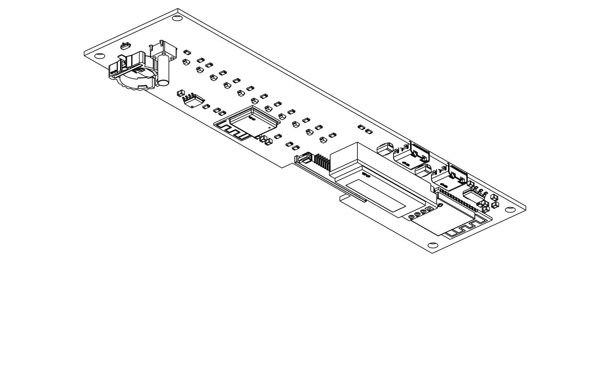
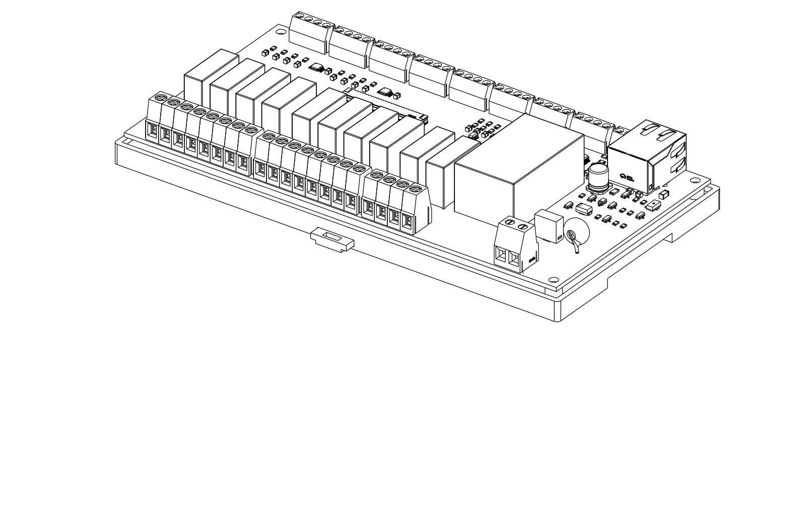
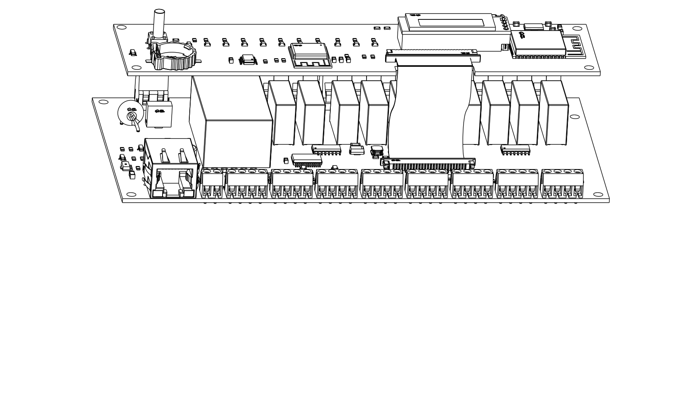

# Ordering and assembly

## 1. Ordering

### 1.1 PCBs (JLCPCB)

For each board, upload:

| Board | Gerber | BOM | CPL |
|---|---|---|---|
| Power/IO | [`hardware/pcb/lower/fab/lower_gerber.zip`](../hardware/pcb/lower/fab/lower_gerber.zip) | [`jlcpcb_bom.csv`](../hardware/pcb/lower/fab/jlcpcb_bom.csv) | [`jlcpcb_cpl.csv`](../hardware/pcb/lower/fab/jlcpcb_cpl.csv) |
| Logic | [`hardware/pcb/logic/fab/logic_gerber.zip`](../hardware/pcb/logic/fab/logic_gerber.zip) | [`jlcpcb_bom.csv`](../hardware/pcb/logic/fab/jlcpcb_bom.csv) | [`jlcpcb_cpl.csv`](../hardware/pcb/logic/fab/jlcpcb_cpl.csv) |

* PCB: 2 layers, FR-4, 1.6 mm, HASL lead-free, 1 oz copper.
* Assembly: **Standard PCBA** (both boards have through-hole parts), PCBA side **Top**.
* After uploading, check the rotation of every part in the placement preview, especially the two USB-C receptacles, the ESP32-H2 module (antenna at the top edge), the FFC connectors and the J3 pin header. On the power/IO board, the wire entries of all screw terminals must face the board edge: J1–J9 the top edge, J21–J24 (230 V) the bottom edge.

### 1.2 Enclosure (JLC3DP)

| Part | File | Material |
|---|---|---|
| Cover | [`cover.stl`](../hardware/enclosure/models/cover.stl) | SLA, CBY resin (alternatives: 9000HE, Grey Resin), with the threaded insert service: 8 × type 5 (M3\*4\*5: 4 corner bosses, 4 logic board bosses), drawing [`inserts_drawing.pdf`](../hardware/enclosure/drawings/inserts_drawing.pdf) |
| Base | [`base.stl`](../hardware/enclosure/models/base.stl) | SLA, CBY resin (same as the cover) |
| DIN latch | [`din_slider.stl`](../hardware/enclosure/models/din_slider.stl) | MJF PA12-HP |
| OLED spacer | [`oled_spacer.stl`](../hardware/enclosure/models/oled_spacer.stl) | MJF PA12-HP (the OLED module is soldered on top of it) |
| LED light rods | [`led_rods.stl`](../hardware/enclosure/models/led_rods.stl) | SLA 8001 clear resin: 11 rods on one carrier bar |

### 1.3 Sourced separately

* 0.91" I²C OLED module (SSD1306, 128 × 32)
* FFC cable: 26 conductors, 1.0 mm pitch, type A (same-side contacts), 80 mm
* 4 × M3 × 12 screws (cover), 4 × M3 × 6 screws (logic board)
* 1 mm clear acrylic or polycarbonate pane for the OLED window (27.1 × 9.7 mm, [`oled_window.dxf`](../hardware/enclosure/models/oled_window.dxf))
* CR1220 coin cell

## 2. Assembly

1. **OLED:** push the spacer onto the J3 header, put the module on top (square pad on square pad) and solder it from above.
   
2. **Cover** (JLC3DP fits the threaded inserts): glue the window pane into the inner pocket. Snip the 11 light rods off their carrier bar, sand both ends matt and push them into the light pipes from inside, flush with the front face.
3. **Logic board** onto the cover bosses on the front-panel side (4 × M3 × 6 into the inserts).
4. **Power/IO board** onto the base bosses. Slide the DIN latch into its guide from below; the spring arms spread in the pocket.
   
5. **FFC:** plug it into the lower connector, then slide the ribbon sideways into the notch of the logic board and plug it into the upper connector.
   
6. **Close** the cover and fit the 4 screws from the back.
7. **Install:** hook onto the rail, tilt in, and connect the wires (screwdriver through the holes on top of the steps).

## 3. Wiring

| Terminal | Connect to |
|---|---|
| NTC 1–8 (S/G) | 10 kΩ NTC floor probes (B = 3950), one per zone, two wires each. Unused inputs read open (> 3.2 V) and report *unknown*. |
| THERMOSTAT 1–8 (S/G) | Dry contacts (relay output of a room thermostat, or a switch). Never connect a voltage. |
| OT (A/B) | OpenTherm boiler terminals; polarity does not matter. |
| LAN | RJ45, 10/100 Ethernet (W5500). Straight-through cable to a switch or router; the W5500 has no auto-MDIX. |
| 230V (L/N) | Mains supply, protected by a breaker in the distribution board. |
| Z1–Z8 (L/N) | 230 V thermoelectric valve actuators of the zones. |
| P1–P2 (L/N) | Circulation pumps (e.g. floor-circuit mixing pump). Check the relay rating against the pump's inrush current. |

If the NTC probes run in existing multi-core cables next to 230 V conductors, isolate the used cores from 230 V at **both** ends and mark them. The 10 µF input capacitors and the firmware median filter handle the 50 Hz pickup.
