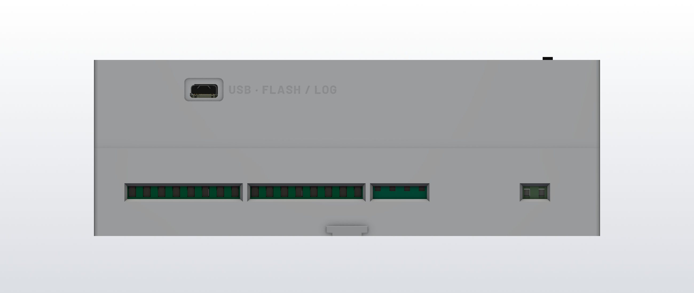
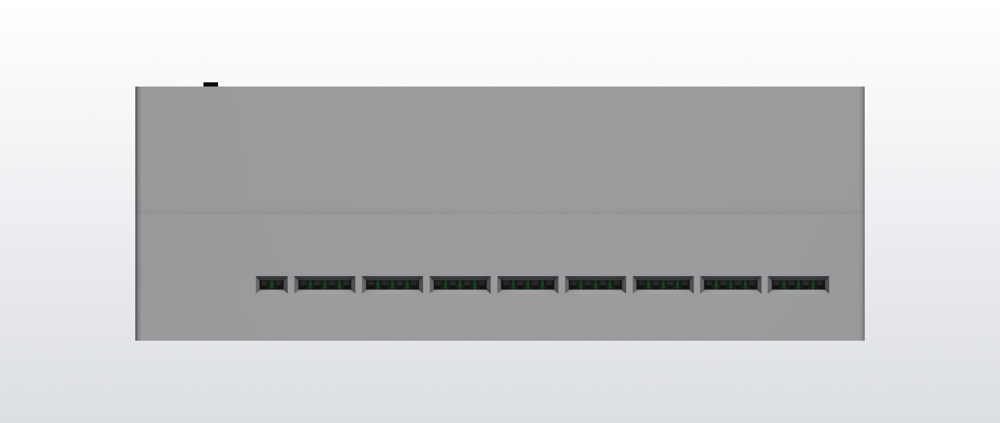
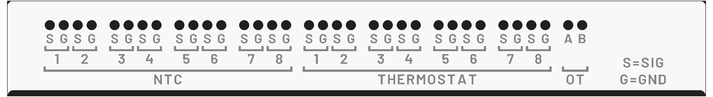
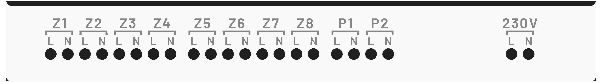
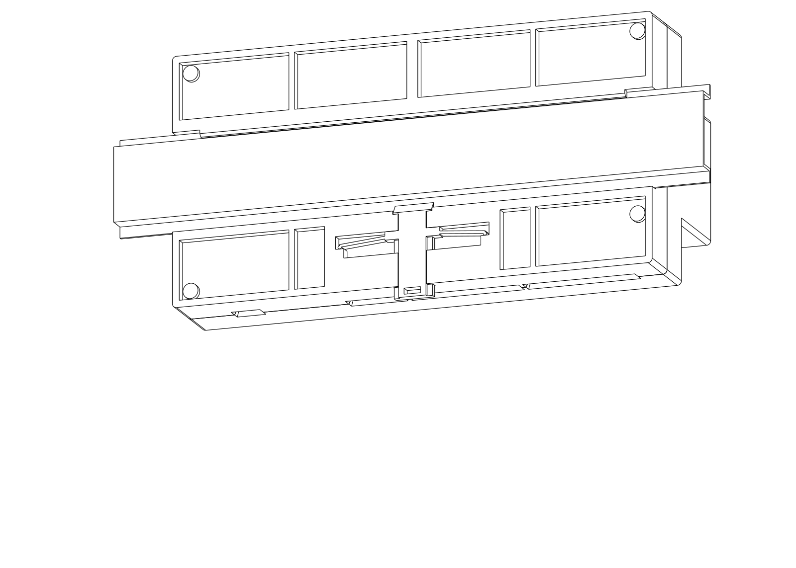
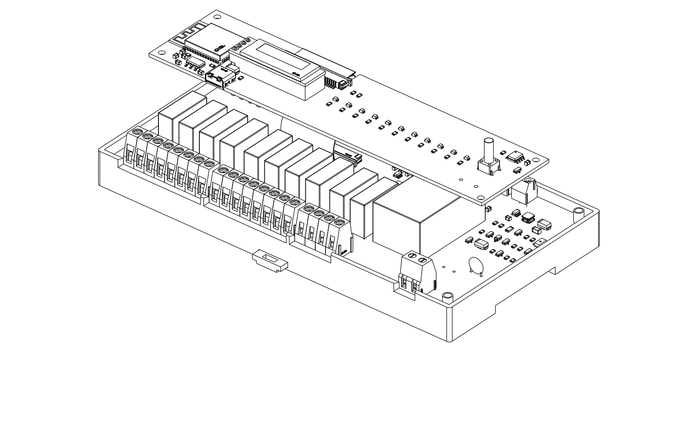
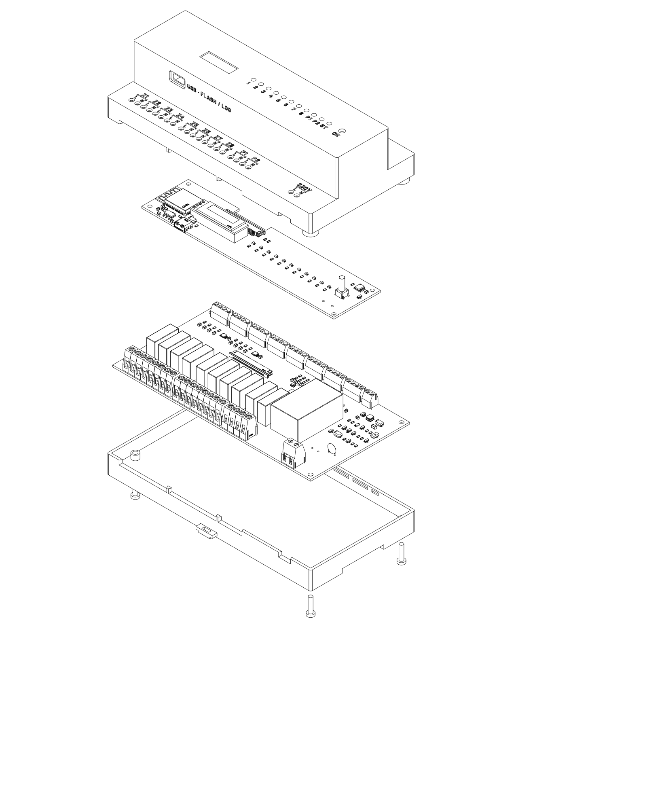
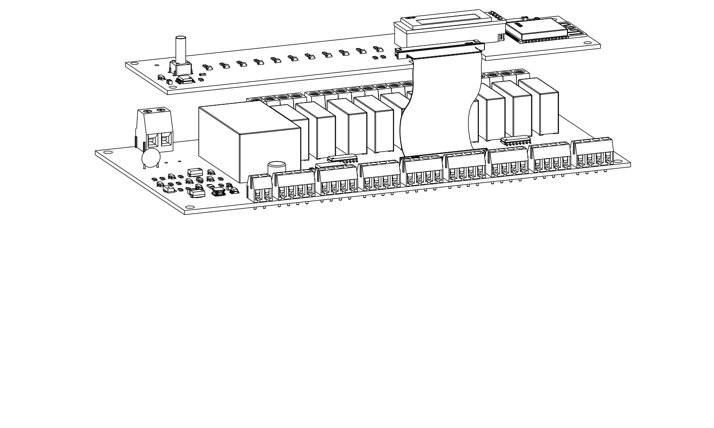

# Enclosure

A 10-module DIN-rail housing with the usual circuit-breaker profile, generated with CadQuery by [`hardware/enclosure/build_enclosure.py`](../hardware/enclosure/build_enclosure.py). It reads the terminal positions from `hardware/lower/terminals.json` and the front-panel layout from `hardware/logic/front.json`, so it follows changes to the boards.

## 1. Dimensions

All values are parameters in `build_enclosure.py`. Check them against an existing modular device before printing.

| Dimension | Value | Note |
|---|---|---|
| Width (along the rail) | 175 mm | 10 × 17.5 mm |
| Height (across the rail) | 90 mm | |
| Nose (the part that comes out through the panel cut-out) | 45 mm high, centred | |
| Depth from rail plane to front face | 57.5 mm | same as the Gainta D9MG instrument housing; to be verified |
| Terminal steps | below and above the nose, 27 mm deep | stay under the distribution board cover |
| Rear foot behind the rail plane | 3.5 mm | holds the DIN hook and the latch |
| Wall thickness | 2.0 mm | never less than 1.15 mm on printed parts |

## 2. Screw terminals

* **Top step: low voltage, 3.5 mm screw terminals (XINLAIYA XY350V, M2, 1 mm²), 34 poles:** 8 NTC + GND, 8 thermostat inputs (dry contact) + GND, OpenTherm A/B.
* **Bottom step: 230 V, 5.08 mm screw terminals (DORABO DB128V, M2.5, 2.5 mm², 16 A / 300 V), 22 poles:** L/N supply, 8 zones L + N, 2 pumps L + N.
* **Placement:** the terminals sit on the board edge, with the wire entry less than 1 mm behind the enclosure wall. Each block has one common opening in the wall, only at the height of the wire holes (inside: 2.2 mm high at the top step, 4.4 mm at the bottom). The opening flares outwards (trapezoidal section, 1 mm larger all round on the outer face) to guide the wire in. The top of each step has one hole per screw, with a screwdriver channel printed into the cover down to the screw head (top Ø2.6 mm for a 2.5 mm screwdriver, bottom Ø3.5 mm for a 3 mm screwdriver). Adjacent channels merge into one solid block per terminal block.

### 2.1 Labels

All labels sit below the screwdriver holes, towards the nose (there is only about 4.8 mm of space above the holes).

* **Top step:** holes → **S/G** (signal/GND; A/B for OpenTherm) → a U-shaped line under each pair → **channel number** (1–8) → a U-shaped line for the block group → **title** (NTC, THERMOSTAT, OT). A legend on the right reads "S=SIG / G=GND".
* **Bottom step:** holes → **L/N** → a U-shaped line per pair → the pair name (Z1–Z8, P1, P2, 230V).
* Engraved 0.8 mm deep in Barlow Bold (SIL OFL, `hardware/enclosure/fonts/`). Pole letters are 3.4 mm high (≈ 0.43 mm stroke), the other labels have ≈ 0.5 mm strokes, and the U-lines are 0.6 mm wide. `hardware/export_labels.py` reads the pole, block and row positions from the power/IO board (`lower/terminals.json`), so the labels follow PCB changes. `BANK_TITLES` replaces the short PCB group name (TERM) with the enclosure label.

## 3. Front panel (the nose)

* **LEDs:** 8 green zone LEDs, 2 yellow pump LEDs and 1 red status LED, with engraved markings below (1–8, P1, P2, ST). Above each LED, a light pipe printed into the cover (Ø3.1 / Ø5.4 mm) reaches down to 0.1 mm above the board, so the LEDs' side emission does not leak into the neighbouring pipe ([section](../hardware/renders/asm_led_section.png)). The pipes work empty (visible head-on), but they are brighter and visible from a wider angle with Ø3 mm clear acrylic rod pushed in (10.5 mm pieces, ends frosted with fine sandpaper). The rod ends flush with the front face.
* **OLED (0.91", 128 × 32):** the window matches the active area from the datasheet, plus 1.5 mm all round. A 1 mm clear acrylic (PMMA) or polycarbonate pane (`hardware/enclosure/oled_window.dxf`, 27.1 × 9.7 mm) is glued from the inside into a 1 mm deep pocket in the cover. A 1 mm frame covers its edge from the outside. The display glass sits 0.8 mm behind the pane ([section](../hardware/renders/asm_oled_section.png)).
* **Push button** (KH-6X6X13H-TJ, 13 mm tall): protrudes 1.1 mm from the front face through a Ø4.2 mm hole, labelled "OK".
* **USB-C:** a stepped opening in the lower side wall of the nose, engraved "USB · FLASH / LOG" (firmware upload and serial log via the ESP32-C6's built-in USB-serial port). Outside, a 13.5 × 8 mm, 1.4 mm deep recess takes the plug overmould (max. 12.35 × 6.5 mm per the USB-C spec), so the plug seats fully. Inside, a tight rim surrounds the receptacle shell (9.6 × 4.7 mm, 0.3 mm gap all round; the shell's front lip reaches 0.85 mm below the board plane), so there is no large gap through which the PCB is visible. The receptacle overhangs the logic board edge by 1.3 mm, and its face is 1.2 mm behind the outer surface. Once installed, the opening may be under the distribution board cover, depending on the nose length. In that case it is only reachable with the cover removed, close to the 230 V terminals.

## 4. Mounting

* **DIN rail (TS35 × 7.5):** the rail channel runs in the rear foot. A fixed hook runs along the top and grips 2 mm behind the rail's upper flange (chamfered tip). A separate printed spring latch (`din_slider.stl`) grips the lower flange.
  * Mounting: hook onto the rail and tilt the housing in. The latch's ramp moves aside and snaps in.
  * Removal: pull the tab at the bottom 3 mm down with a screwdriver and tilt the housing off.
  * The latch slides into its guide from the bottom of the housing. Its two 1 mm spring arms spread inside the pocket, bear against the stops and hold the latch captive ([renders](../hardware/renders/asm_din_slider.png), [section](../hardware/renders/asm_din_section.png)).

  
* **Cover and base:** 4 × M3 × 12 screws from the back, from pockets in the foot. Each screw passes through the base boss (Ø3.4 mm hole) and the power/IO board corner hole (Ø3.2 mm, `MountingHole_3.2mm_M3`) into the cover boss, so one screw clamps both the board and the cover. The housing can only be opened when it is off the rail (230 V: live parts are reachable only with a tool).
  * **H2, H3, H4:** threaded inserts fitted by JLC3DP, type 5 (M3\*4\*5: M3, 5 mm long, Ø4.0 mm; hole Ø3.6 × 7 mm, already in the model). JLC3DP asks for at least 3 mm of wall around an insert, so these bosses are Ø9.8 mm with no parts underneath (checked against the board 3D model). H3 was moved up for this (3.5; 69.0, between terminal J21 and relay K1).
  * **H1:** a boss that large does not fit (the NTC 1-2 terminal starts 2.3 mm away), so H1 is a flattened Ø5.6 mm boss with a Ø2.7 mm pilot hole, and the M3 screw cuts its own thread into the plastic. Do not overtighten it.
  * The 2D drawing required for ordering is `hardware/enclosure/inserts_drawing.pdf` (and `.png`): the cover seen from below, with insert positions and types. `export_insert_drawing.py` creates it from `cover.stl` and `inserts.json`.
* **Logic board:** 4 × M2.5 self-tapping screws into the cover bosses on the front-panel side. The cover lifts off together with the logic board; unplug the FFC at one end.

## 5. Printing

* **Parts:** `base.stl` (base with foot), `cover.stl` (cover) and `cover_color.3mf` (the same with coloured labels), `din_slider.stl` (DIN latch), `oled_spacer.stl` (OLED spacer), plus `enclosure.step` (assembly). All are generated from CadQuery.
* **Cover: JLC3DP, MJF PAC-HP (full-colour nylon), `cover_color.3mf`.** The 3MF is coloured per triangle: light grey body (#D7D7D7), dark labels (#1E1E1E) on the floor and walls of the engraving. The colours are the `COLOR_BODY` / `COLOR_LABEL` parameters. Printed colours may be duller; without colour data JLC3DP prints it grey.
* **Other parts: JLC3DP, MJF PA12-HP** (grey). Tough (the latch spring arms survive) and dimensionally accurate. Resin (SLA) is not suitable: too brittle.
* **Labels:** JLC3DP recommends 0.8 mm depth and width for engraved details. The depth matches; the strokes are thinner (0.43–0.6 mm), and the resulting warning is acceptable.
* **Own FDM printing:** ASA or PETG. Print the base back-down on the bed (the rail channel ceiling is a 35.6 mm bridge) and the latch flat.
* **Wall thickness:** at least 1.15 mm everywhere (about 1 mm is the recommended MJF minimum). The exceptions are the 1 mm latch spring arms, which have to flex, and the 0.9 mm thinnest point between the top screwdriver channels (3.5 mm pitch, merged into a block). Warnings about these are acceptable.
* **Flammability:** neither PA12 nor ASA/PETG is rated V-0. This is fine for personal use; a product for sale needs a flame-retardant material.

## 6. Collision check

The cover, the spacer and the base were checked against the 3D models of both boards and touch no component, including the Ø9.8 mm insert bosses.

| Exploded (with screws) | Boards and FFC |
|---|---|
|  |  |
