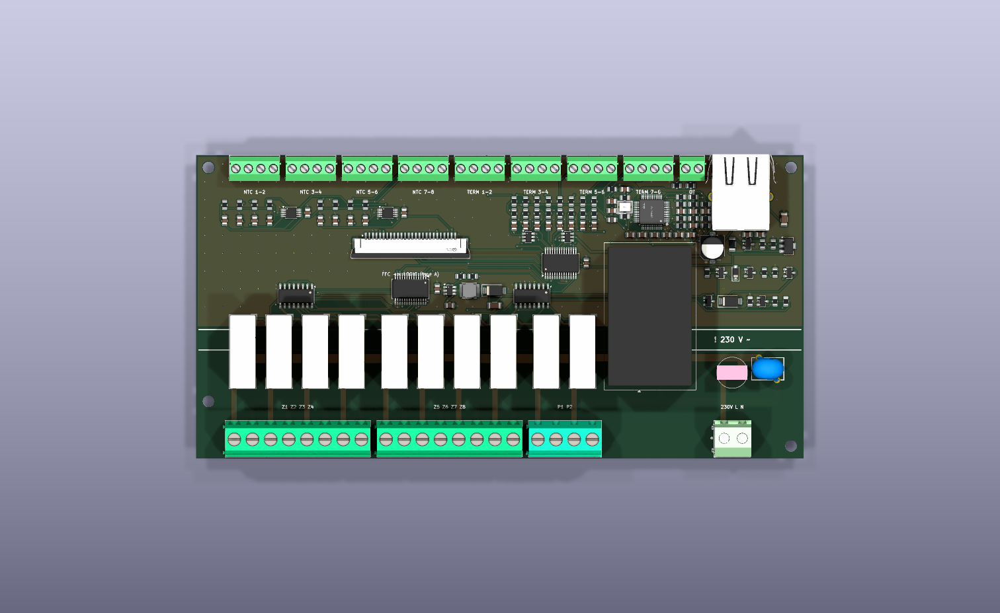
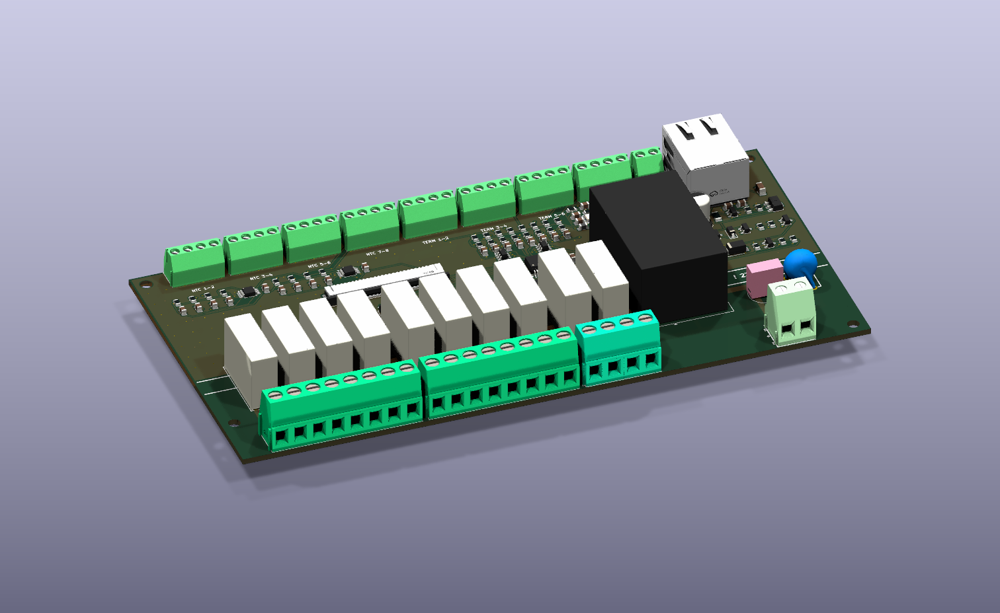
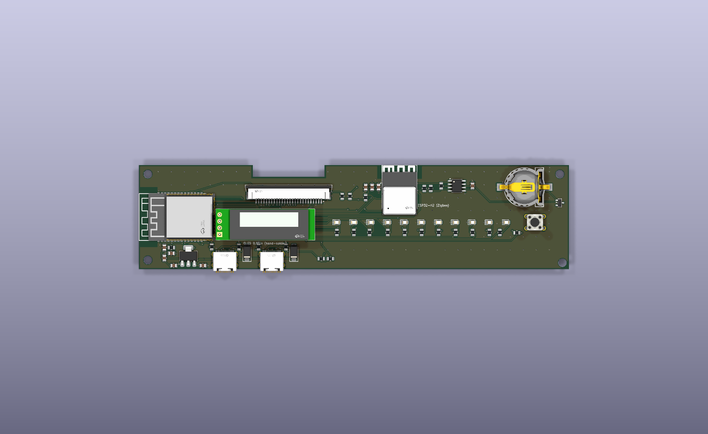
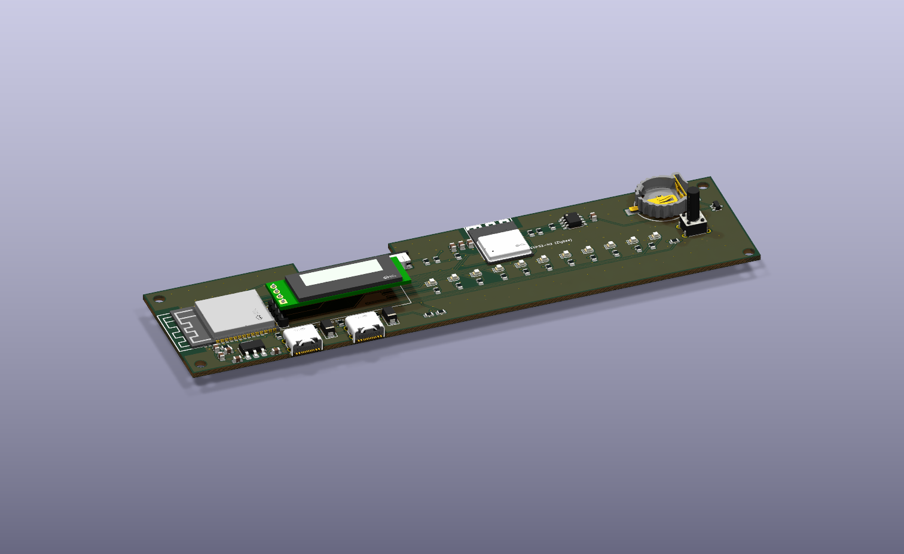

# Hardware

The controller uses two PCBs connected by a 26-way FFC ribbon:

* the **power/IO board** (`hardware/pcb/lower/`, 170 × 85 mm), which covers the whole floor of the enclosure;
* the **logic board** (`hardware/pcb/logic/`, 165 × 40 mm), which sits in the front nose directly behind the front panel.

Every input and output sits next to its own screw terminal on the power/IO board. Analog lines and 24 V lines therefore stay short and never pass through the ribbon cable.

| Power/IO board, top | Power/IO board, iso |
|---|---|
|  |  |

| Logic board, top | Logic board, iso |
|---|---|
|  |  |

## 1. Power/IO board (`hardware/pcb/lower/`)

### 1.1 Mains section (bottom edge)

* 10 × Omron G5NB relays, each placed directly above its own L terminal.
* HLK-5M05 AC/DC module. It straddles the isolation gap, and the cover has a recess above it.
* T2A fuse (Walter TR5, footprint-compatible with the Littelfuse 372) and a 07D471K varistor. The varistor (C28756) has splayed leads (5.0 mm along, 6.2 mm across), so it uses its LCSC footprint with diagonal pins instead of a generic 5 mm disc footprint; otherwise it does not line up in the JLCPCB placement.
* Screw terminals with 8 + 8 + 4 + 2 poles: Z1–Z4, Z5–Z8, P1–P2 and the L/N supply (DORABO DB128V-5.08: C5143711 / C2915641 / C2915639). They sit on the bottom edge of the board (pad row at y = 79.4 mm).

### 1.2 Isolation

* A copper-free band of at least 6.5 mm (KiCad keep-out zone) between mains and low voltage.
* DRC rules: 6 mm between mains and low-voltage nets, 2 mm between mains poles.

### 1.3 Low-voltage section (top edge)

Screw terminals on the top edge of the board (pad row at y = 3.6 mm, 1.0 mm between blocks): 8 × 4-pole + 1 × 2-pole 3.5 mm terminals (XINLAIYA XY350V-3.5: C557656 / C784942) for NTC1–8 + GND, TERM1–8 + GND and OpenTherm A/B. Below them:

* **Floor NTC measurement:** 2 × ADS1115 (I²C 0x48, 0x49) with dividers: 3V3 – 10 kΩ 0.1 % – input – NTC – GND, and a 10 µF X5R capacitor from each input to GND.
  * The 10 µF capacitors (C21–C28) replaced the original 100 nF parts. Probes often run in old thermostat cables next to 230 V conductors and pick up 50 Hz hum: on the predecessor board the raw input voltage jumped by ±47 mV, about ±1.2 °C. With roughly 5 kΩ source impedance (10 kΩ ∥ 10 kΩ NTC) the RC time constant is about 50 ms, which attenuates 50 Hz by about 24 dB. The firmware adds a median filter on top (see [firmware.md](firmware.md)).
  * Two chips are enough: they sample all 8 channels in about 35 ms, so with one reading per minute they are busy less than 1 % of the time. Addresses 0x4A and 0x4B are free if more inputs are ever needed.
* **Thermostat inputs (dry contact):** ESD protection (2 × SRV05-4), 1 kΩ pull-up (≈ 3.3 mA wetting current), series 1 kΩ + 100 nF. They go to MCP23017 #2 (0x21). GPA0–7 are TERM8–TERM1: the order is reversed to keep the routing free of crossings, so the firmware has to map it. GPB drives the zone LEDs on the logic board.
* **OpenTherm master:** see the [schematic](../hardware/pcb/schematics/opentherm_master.svg) and section 3.
* **Relay drivers:** MCP23017 #1 (0x20) + 2 × ULN2003A.
* **Ethernet (10/100):** WIZnet W5500 (U30, LCSC C32843) on SPI to the ESP32-S3 through the FFC, and an RJ45 jack with integrated magnetics and LEDs (J40, WIZnet J1B1211CCD, C910371) at the right end of the top edge, its opening in the top step wall like the terminal wire entries (labelled LAN). The circuit follows the W5500 datasheet (12.4 kΩ 1 % EXRES1, 4.7 µF TOCAP, 10 nF 1V2O, 25 MHz crystal with 18 pF / 1 MΩ / 0 Ω, auto-negotiation via open PMODE pins) and the PHY side of WIZnet's W5500-EVB-Pico (3.3 Ω series + 49.9 Ω to 3.3 V on TX, 6.8 nF + 3.3 Ω and 2 × 49.9 Ω to a 100 nF common node on RX, TCT via 10 Ω + 22 nF, shield to chassis via 1 nF / 2 kV). It is supplied from +3V3 through a ferrite bead (~130 mA), so the logic board's AMS1117 now carries the ESP32-S3, the ESP32-H2 and the W5500 (about 0.4 W average dissipation). Reset is an RC power-on reset (no reset line). Untested: the two Ethernet pairs run about 15 mm on the board without impedance control, which is fine for 10/100 at this length.
* **OpenTherm 24 V boost converter** (MT3608, L1, D20, C40, C41, feedback R50/R51): above the relays, x ≈ 68–87 mm (it used to sit where the RJ45 is now).

### 1.4 FFC connector to the logic board (J30)

26-pin, 1.0 mm pitch, 90° JUSHUO AFA07-S26FCA (LCSC C2681942). Its opening faces the logic board.

| Pin | Signal |
|---|---|
| 1–2 | +5V |
| 3–4 | GND |
| 5 | SDA |
| 6 | SCL |
| 7 | OT_TX |
| 8 | OT_RX |
| 9–16 | Zone LED 1–8 |
| 17 | MCP_INT |
| 18 | ETH_SCK (W5500) |
| 19 | GND |
| 20 | ETH_MOSI |
| 21 | ETH_MISO |
| 22 | ETH_CS |
| 23 | ETH_INT |
| 24 | GND |
| 25 | +3V3 (supplied by the logic board) |
| 26 | GND |

## 2. Logic board (`hardware/pcb/logic/`)

It sits in the nose of the enclosure, directly behind the front panel (Z = 44 mm above the base).

* **MCU:** ESP32-S3-WROOM-1-N16R8 (U1, LCSC C2913202): dual-core Xtensa LX7, 16 MB quad-SPI flash, 8 MB octal PSRAM (IO35–IO37 are taken by the PSRAM), Wi-Fi 4 (2.4 GHz 802.11b/g/n) and Bluetooth LE 5; no 802.15.4 radio of its own (Zigbee / Thread run on the H2). The PSRAM is what makes the Matter controller of the Thread/Matter firmware possible. **The module is rated −40…65 °C ambient** (the PSRAM limits it), lower than the 85 °C of the plain modules: keep the enclosure out of hot spots such as directly above a boiler. The antenna is at the left edge of the board, over a copper-free area. AMS1117-3.3 regulator; USB-C (J2, "MAIN") with VBUS through an SS34 diode. Power: the S3 draws up to about 350 mA peaks while transmitting on Wi-Fi (about 100 mA average when connected, less with Wi-Fi off in an Ethernet-only setup); together with the H2 and the W5500 the 3.3 V peak load stays below about 0.7 A, within the AMS1117 rating, and its average dissipation is about 0.4 W (see the Ethernet bullet). Strapping pins IO3, IO45 and IO46 are left unconnected (defaults); IO43/IO44 (UART0) are unused.
* **802.15.4 co-processor (Zigbee or Thread):** ESP32-H2-MINI-1-H4S (U7, LCSC C47967030; 105 °C, 4 MB flash – the N4 variant is not stocked at JLCPCB), antenna at the top edge over a copper-free area. It has its own USB-C (J4, "RADIO", next to J2, VBUS through its own SS34 diode) for flashing and logging, and a UART to the S3. The S3 also drives the H2's EN and BOOT (GPIO9) lines, so it can reset the H2 or put it into download mode (the Thread/Matter firmware uses this to flash the RCP image), and four Wi-Fi / 802.15.4 coexistence (PTA) lines connect the two chips. It runs either a Zigbee coordinator ([`firmware/zigbee-coordinator`](../firmware/zigbee-coordinator), ESP-IDF + Espressif Zigbee SDK) that passes room and outdoor readings to the S3 over the UART ([protocol](coprocessor-protocol.md)), or the OpenThread RCP ([`firmware/h2-rcp`](../firmware/h2-rcp)) for the S3's Thread border router; both compiled, not yet tested on hardware.
* **RTC:** DS3231MZ with a CR1220 backup cell (BS-12 holder). The holder's polarity is not documented, so the cell is connected through a series Schottky diode: if the cell goes in reversed, nothing is damaged and there is simply no backup.
* **OLED:** a 0.91" module (SSD1306, I²C 0x3C) on a 4 mm printed spacer, mounted on a 1 × 4 pin header (J3: PZ254V-11-04P, LCSC C492403, soldered by JLCPCB). **The module itself must be soldered by hand**: JLCPCB supplies it without pins, so they cannot place it, and a bare FPC display is not available as a part. Any common 0.91" module works (e.g. HS91L02W2C01, C5248081). Pin order with the pins bent left, bottom to top: GND, VCC, SCL, SDA. The square pad 1 is GND on both the module and the PCB. The active area (22.38 × 5.58 mm) is not centred on the module: per the HS91L02W2C01 drawing it is 0.87 mm off centre towards the SDA pin, so the module sits 0.87 mm lower and its *screen* is on the same line as the LEDs and the button (`PANEL_Y` / `OLED_AA_DY` in `build_logic.py`; the front-panel window follows the active area). A module from another maker may differ: check its drawing.
* **LEDs and button:** 8 green, 2 yellow and 1 red 0805 LED (330 Ω), plus a 13 mm tactile switch (KH-6X6X13H-TJ) on IO0, which is also BOOT.
* **Single-side assembly:** all parts are on the top side. A 27.5 × 4.5 mm notch in the top edge holds the 90° FFC connector (J1), which sits at the notch edge facing into it. This is why the OLED sits 5.8 mm lower; the front-panel window and the spacer follow it.

### 2.1 ESP32-S3 pin assignment

| GPIO | Function |
|---|---|
| IO0 | Button (BOOT strap, 10 kΩ pull-up) |
| IO19 / IO20 | USB D− / D+ (built-in USB-Serial/JTAG, J2 "MAIN") |
| IO8 | I²C SDA |
| IO18 | I²C SCL |
| IO17 | OpenTherm TX |
| IO16 | OpenTherm RX |
| IO4 / IO5 / IO6 | LED pump 1 / pump 2 / status |
| IO7 | RTC interrupt |
| IO15 | MCP23017 interrupt |
| IO10 / IO11 | UART TX → H2 RXD0 (GPIO23) / RX ← H2 TXD0 (GPIO24) |
| IO12 / IO13 | H2 EN (reset; 10 kΩ pull-up, 1 µF) / H2 BOOT (GPIO9; 10 kΩ pull-up) |
| IO14 / IO21 | PTA REQUEST ← H2 GPIO2 / PTA PRIORITY ← H2 GPIO3 |
| IO47 / IO48 | PTA GRANT → H2 GPIO4 / PTA TX_LINE → H2 GPIO5 |
| IO39 / IO40 / IO41 | Ethernet W5500 SPI SCK / MOSI / MISO |
| IO42 | Ethernet W5500 CS (4.7 kΩ pull-up) |
| IO38 | Ethernet W5500 INT (4.7 kΩ pull-up) |
| IO35–IO37 | Octal PSRAM (internal, not available) |
| IO3, IO45, IO46 | Strapping pins, unconnected |
| IO43 / IO44 | UART0, unused |

The PTA lines carry Espressif's 4-wire external coexistence (S3 = leader, H2 = follower); only the Thread/Matter firmware uses them, and only in its build variant without BLE (see [firmware/thread-matter](../firmware/thread-matter/README.md)). The Ethernet SPI pins IO39–IO42 double as the S3's JTAG pins; JTAG debugging goes through the USB-Serial/JTAG instead.

### 2.2 ESP32-H2 pin assignment

| Module pin (GPIO) | Function |
|---|---|
| 30 (GPIO23, RXD0) / 31 (GPIO24, TXD0) | UART to the S3 |
| 26 / 27 (GPIO26 / GPIO27) | USB D− / D+ (built-in USB-serial/JTAG, J4 "RADIO") |
| 8 (EN) | 10 kΩ / 1 µF, driven by S3 IO12 |
| 23 (GPIO9, BOOT strap) | 10 kΩ pull-up, driven by S3 IO13 |
| 5 / 6 (GPIO2 / GPIO3) | PTA REQUEST / PRIORITY → S3 IO14 / IO21 |
| 18 / 19 (GPIO4 / GPIO5) | PTA GRANT / TX_LINE ← S3 IO47 / IO48 |
| 22 (GPIO8, strap) | 10 kΩ pull-up |

### 2.3 I²C devices

| Address | Device | Board |
|---|---|---|
| 0x20 | MCP23017 #1: relay drivers | power/IO |
| 0x21 | MCP23017 #2: thermostat inputs (GPA), zone LEDs (GPB) | power/IO |
| 0x3C | SSD1306 OLED | logic |
| 0x48 | ADS1115 #1: NTC 1–4 (AIN3…AIN0 = NTC1…NTC4) | power/IO |
| 0x49 | ADS1115 #2: NTC 5–8 (AIN3…AIN0 = NTC5…NTC8) | power/IO |
| 0x68 | DS3231M RTC | logic |

### 2.4 Ribbon cable

26 conductors, 1.0 mm pitch, **type A (contacts on the same side at both ends)**, 80 mm long. It leaves the lower connector, loops back over it, rises vertically through the notch in the logic board and turns horizontally into the upper connector at the top ([render](../hardware/renders/asm_boards_ffc_notch.png)). The notch is open, so the ribbon slides in from the side, and its whole path stays on the low-voltage side. **Why type A:** J30 and J1 are the same part (bottom contact), and each sits on the top side of its board. The ribbon leaves J30 heading +Y with its contact face down. The loop back over the connector turns that face up. Rising through the notch turns it to face +Y, and the final bend into J1 turns it down again. So the same face of the ribbon touches the contacts at both ends. Type B would only be needed if one connector sat on the underside of its board, as in an earlier draft. The ribbon also does not twist sideways, so each conductor keeps its X position. J30 pin *n* therefore meets J1 pin 27 − *n* (J1 is rotated 180°), and the nets are assigned by pad X position. All 26 positions were checked against both board files.

## 3. OpenTherm master interface

[Schematic](../hardware/pcb/schematics/opentherm_master.svg) (generated by `hardware/pcb/schematics/opentherm_master.py`).

The master supplies the line voltage, and the boiler answers by modulating its current draw.

* **24 V supply:** MT3608 boost converter from 5 V (390 kΩ / 10 kΩ feedback).
* **High level:** Q1 (Nexperia BCX56, SOT-89) as an emitter follower. Its base is held at 19.5 V by a TL431 (CJ431) with a 68 kΩ / 10 kΩ divider.
* **Low level:** the ESP's OT_TX pulls the base down to a 4.3 V Zener through Q3.
* **Current limit:** about 43 mA (R5 15 Ω + Q2), as short-circuit protection.
* **Receive:** a 47 Ω shunt in the return path; Q4 switches above about 12.8 mA and drives OT_RX.
* **Polarity-independent:** 2 × BAT54S bridge, plus an SMAJ24A TVS after the terminal.

Calculated levels at the boiler: high 16.4–17.5 V, low ≈ 2.9 V, receive threshold ≈ 12.8 mA. These still need a prototype test (see [open-issues.md](open-issues.md)).

## 4. Assembly data notes

* **JLCPCB CPL positions:** for KiCad standard footprints the position is the courtyard centre. For LCSC (EasyEDA) footprints it is the footprint origin, which is the JLCPCB part centre. For the AFA07 FFC connector it is the point between the pad row and the mounting-tab row.
* **3D models:** all LCSC models are referenced as STEP. The WRL origins differ, which earlier made the KiCad render and the STEP export disagree. Missing or wrong models are replaced by `pcbgen.MODEL_FIX`: the AFA07 FFC (LCSC model), the push button (KiCad's 13 mm model) and the TR5 fuse (KiCad has no model for the Littelfuse 372 footprint; the LCSC model of C354902). The J3 header also carries the OLED module model, for visualisation only.
* The JLCPCB preview and the LCSC package show a generic 5 mm button model; the real part is 13 mm tall.
